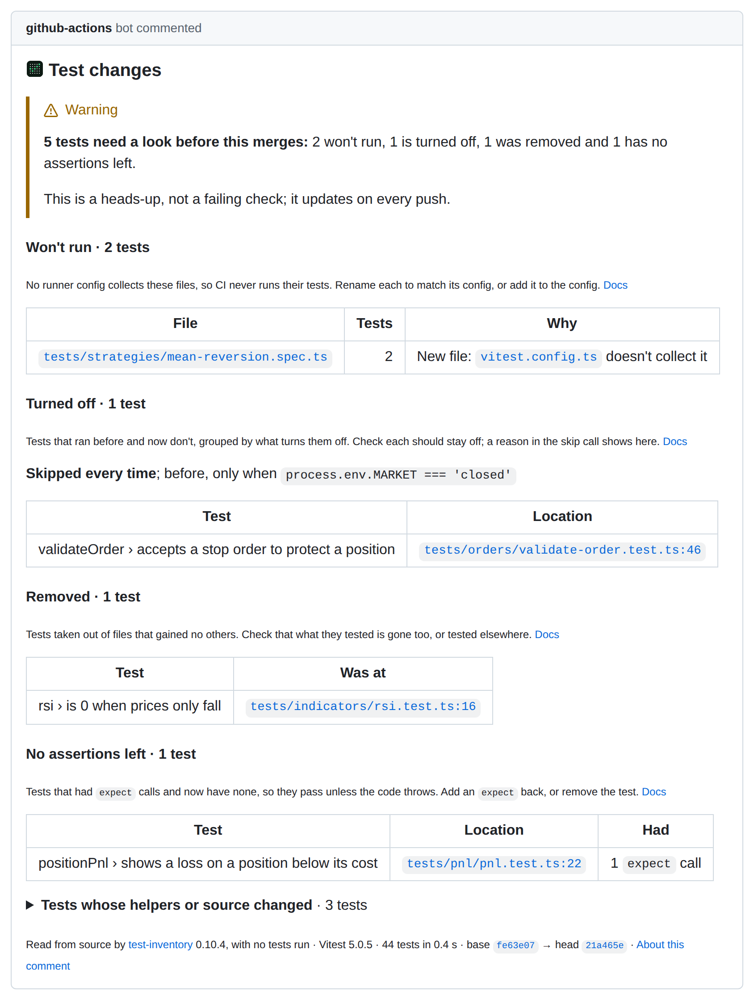

# test-inventory-action

Comments on each pull request with what it does to the tests, without running them.

The action scans the pull request's base and head with [test-inventory](https://github.com/Huldoser/test-inventory),
which reads Playwright, Vitest, Jest, Mocha, Jasmine, Cypress, WebdriverIO, node:test and Bun tests from source. Typical
suites scan in under a second, with no build, no browsers and no install of your project, and the action never fails a
check.

Available on [GitHub Marketplace](https://github.com/marketplace/actions/test-changes-by-test-inventory) · [Documentation](https://huldoser.github.io/test-inventory/)

<picture>
  <source media="(prefers-color-scheme: dark)" srcset="docs/comment-dark.png">
  
</picture>

The comment shows what a reviewer should look at:

- **Won't run**: a new test file no runner config collects, or tests a config change stopped collecting.
- **Turned off**: existing tests that now skip, grouped by the condition or reason, and tests that skipped only on a
  condition, such as a missing secret, and now always skip.
- **Removed**: tests taken out of a file that gained none.
- **Test files deleted**.
- **No assertions left**: tests that had `expect` calls and now have none.

The rest is collapsed:

- tests rewritten or replaced in the same file;
- renamed or moved tests;
- tests whose helpers or source changed;
- fewer assertions;
- added tests.

When nothing needs a look, the action posts no comment, or updates its earlier one to say so.

## Alongside your test results reporter

A results reporter says which tests passed and failed in a run. This action reads the tests themselves, before
anything runs, so it covers what a run can't show:

- tests no runner config collects, which no run reports;
- the condition and reason that turn a test off;
- a renamed test as a rename, rather than a removal and an addition;
- a test that lost its assertions, which a run still counts as passed;
- pull requests whose tests didn't run at all, such as when a path filter skipped the job.

It needs no reporter setup, results file or account, and it runs none of the pull request's code, so it works the same
on pull requests from forks. Keep your reporter for failures and timings: the two answer different questions.

## Usage

**Why two workflows?** The first workflow scans with read-only permissions, and the second posts the comment without
ever checking out pull request code. That split keeps `pull-requests: write` isolated so comments work safely on pull
requests from forks too.

```yaml
# .github/workflows/test-changes.yml
name: Test changes
on: pull_request
permissions:
  contents: read
jobs:
  scan:
    runs-on: ubuntu-latest
    steps:
      - uses: actions/checkout@3d3c42e5aac5ba805825da76410c181273ba90b1 # v7.0.1
        with:
          persist-credentials: false
      - id: tests
        uses: Huldoser/test-inventory-action@9eb10816dd1ecae4917ffc31de605aa2674d0d10 # v0.2.6
      - uses: actions/upload-artifact@cf430e030ddbb5b0abf93d22962f4752f3646cd9 # v7.0.2
        with:
          name: test-inventory-report
          path: ${{ steps.tests.outputs.report-dir }}
          if-no-files-found: ignore
```

```yaml
# .github/workflows/test-changes-comment.yml
name: Test changes comment
on:
  workflow_run:
    workflows: [Test changes]
    types: [completed]
permissions:
  actions: read
  pull-requests: write
jobs:
  comment:
    if: github.event.workflow_run.event == 'pull_request' && github.event.workflow_run.conclusion == 'success'
    runs-on: ubuntu-latest
    steps:
      - uses: Huldoser/test-inventory-action@9eb10816dd1ecae4917ffc31de605aa2674d0d10 # v0.2.6
        with:
          mode: comment
```

Pin the action to a full commit SHA, as in the examples, and let Dependabot or your workflow lockfile move the pin.

The scan measures the pull request against its base branch as it is now: `actions/checkout` checks out the pull
request merged into that branch, and the action compares the merge with the branch. A workflow that checks out the
pull request's head commit instead gets it compared with where it last met the base branch, which the action asks
GitHub for with the job's token.

The comment workflow reads the report the scan uploaded as data and checks it field by field. It posts only if the
pull request is still at the commit that was scanned, and only edits a comment a bot wrote.

If your repository runs [zizmor](https://docs.zizmor.sh/), its `dangerous-triggers` audit flags every `workflow_run`
trigger; because this workflow checks out no code, reads the report strictly as data and checks the pull request head
commit, you can add `# zizmor: ignore[dangerous-triggers]` on the `workflow_run:` line.

### Pull requests from forks

A pull request from a fork runs the fork's own copy of the scan workflow, so its author controls what the report says
and can drop a step that gates on the outputs. The comment workflow keeps the report from posting links, mentions or
markup of its own, but it can't tell an honest report from a made-up one. On a fork's pull request, read the comment
as a guide to the diff, not as proof, and keep any gate in a workflow the fork can't change. GitHub asks a maintainer
to approve workflow runs from first-time contributors.

## Inputs

| Input             | Default                 | What it does                                                                                                                                                |
| ----------------- | ----------------------- | ----------------------------------------------------------------------------------------------------------------------------------------------------------- |
| `mode`            | `scan`                  | `scan` in the `pull_request` workflow, `comment` in the `workflow_run` workflow.                                                                            |
| `github-token`    | `${{ github.token }}`   | Downloads the report and writes the comment, in comment mode. In scan mode, fetches the base commit and finds where a checked-out head met the base branch. |
| `artifact-name`   | `test-inventory-report` | The artifact comment mode downloads; match the scan's upload.                                                                                               |
| `timeout-minutes` | `10`                    | The time the scan may take; past it the action stops and writes no report.                                                                                  |

## Outputs

`wont-run`, `turned-off`, `removed` and `asserts-nothing` count the tests in those sections, and `report-dir` is the
folder with `report.json`. The action never fails because of what it finds. To make a finding block a pull request,
add a step of your own:

```yaml
- if: steps.tests.outputs.wont-run != '0'
  run: |
    echo "::error::Some tests in this pull request won't run; see the job summary."
    exit 1
```

## What it can't see

The scan reads source and configs; it runs nothing. These are out of its reach:

- Tests registered at run time, configs computed from environment variables, and settings it can't work out, which it
  reports as unknown rather than guess.
- A config named only in a CI workflow, or chosen by a wrapper script, rather than in a package.json script.
- A runner that no package.json lists and that has no config file of its usual name, other than Node's and Bun's
  built-in runners.
- Very large repositories may pass the time limit; the job summary then says so.

[Known limits](https://huldoser.github.io/test-inventory/guide/limits) has the scanner's full list.

## Requirements

Node.js 22.12 or newer on the runner, which every GitHub-hosted image has. Self-hosted runners may need
`actions/setup-node` first. The action needs network access to npm to install test-inventory.

## Part of test-inventory

- [test-inventory](https://github.com/Huldoser/test-inventory): CLI and Node.js library (`npx test-inventory`).
- [test-inventory-mcp](https://github.com/Huldoser/test-inventory-mcp): MCP server for Claude Code, Cursor, VS Code and other AI clients.
- [Documentation](https://huldoser.github.io/test-inventory/): framework guides, query recipes and output reference.

## License

[MIT](LICENSE), copyright © 2026 Andrey Rychkov.
